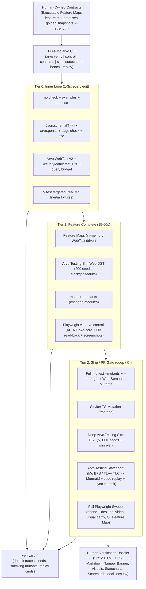

# Arvo Verification & Testing Architecture & Roadmap

> **Built for AI-authored software with minimal human review:** when agents write almost all of the code, tests can no longer be an afterthought or a rubber stamp. Verification must be **fast in the inner loop**, **adversarial against weak tests**, **honest about which surface it proved**, and **readable by a human in under two minutes**.

- **Companion Spec:** [arvo-testing-spec.md](arvo-testing-spec.md)
- **Companion Framework Docs:** [arvo-plan.md](arvo-plan.md) · [arvo-spec.md](arvo-spec.md)
- **Status:** The upstream prerequisites landed in [Mo #439](https://github.com/robertguss/mo/pull/439). [Arvo #3](https://github.com/robertguss/arvo/pull/3) adds documentation only; [Arvo #4](https://github.com/robertguss/arvo/pull/4) through [#13](https://github.com/robertguss/arvo/pull/13) carry the Phases 1–5 implementation. The roadmap describes the target architecture and exit criteria, not features available in an existing Arvo installation or evidence that the gates have passed.
- **Architectural Split:** Arvo-first (pure Mo libraries + pure Mo `arvo` CLI + bundled agent skills), paired with 5 small, high-leverage upstream Mo runtime/compiler additions.
- **Backend Split:** Core modules such as `Arvo.WebTest`, `Arvo.Inertia`, `Arvo.Snapshot`, and `Arvo.Props` stay storage-agnostic. Additional harnesses live under `lib/arvo/testing/` as `Arvo.Testing.*`. SQLite query budgets, SQL read-back, and starter end-to-end workflows described here target the SQLite starter, not the MoDB starter.

---

## 1. The Core Problem: Why Standard Testing Fails When AI Writes the Code

Traditional testing assumes a human author who understands intent, writes conservative code, and reviews every PR line by line. When AI agents write both implementation and tests and human review is minimal, five failure modes dominate:

1. **Circular validation (tautological tests):** An agent writes buggy code, then writes tests that mirror the implementation rather than the contract. Everything turns green while the feature is broken.
2. **Spec and snapshot tampering:** When a test or snapshot fails, an agent under pressure weakens an assertion, edits a `.feature` step, or updates a golden snapshot to get a green check.
3. **Wrong-surface verification:** Passing unit tests or a clean compile get reported as "verified" when the real UI is broken, a form label is missing, a session cookie fails under `Secure`, or an Inertia prop renders `NaN`.
4. **Cross-boundary drift (where grep stops):** Mo backend (`Inertia.render` JSON maps, SQLite columns, HTTP error codes) silently drifts from React/TypeScript (`interface HomeProps`, form field names, error bags) while both `mo check` and `tsc` pass independently.
5. **Rare interleaving & concurrency bugs:** Optimistic locking races between two users, stale `arvo_jobs` locks, mid-transaction crashes, retry storms, expired sessions, and out-of-order external API faults live on paths hand-written example tests rarely reach.

### Six Non-Negotiable Design Rules

Synthesizing Mo's capability discipline, Arvo's explicitness, and the verification principles proven in `pstack`:

1. **Fix mistake classes at the highest level (`Architecture > Types > Lint > Test > Docs`).** Eliminate drift with compiler-checked types (`Json.schema[T]()` → `arvo.gen.ts`) and fail-closed defaults before writing a single test. Docs and rules are last because nothing fails when an agent skips them.
2. **Every check must be proven able to fail.** A test, property, security check, or formal model you have never seen catch a broken variant proves nothing. We enforce this structurally via `mo test --mutants`, `mo test --strength`, web-semantic mutants, Stryker TS mutation, and failing-before regression tests.
3. **Match proof to the surface.** Compilation is not runtime proof; a unit test is not UI proof; a UI toast is not persistence proof (reopen from the list *and* read back SQLite / `arvo_events`).
4. **Tamper-evident human-owned contracts.** Human-readable Executable Feature Maps (`.feature.md`), `promise` invariants, `--strength` wrong versions, and golden snapshots are tracked separately from implementation diffs. Any AI edit to them raises a top-level **Contract Changed** banner for human approval.
5. **Shared Control Adapter.** The adapter uses `mo serve` and Arvo conventions to give compatible apps isolated ephemeral launch, `doctor`, ARIA-first browser driving, evidence that survives cleanup, and teardown. Read-only SQLite and audit inspection rely on the starter's storage and audit setup.
6. **Independent verification & visual-first human briefings.** Separate the author from the verifier, log every claim to an append-only `decisions.tsv` evidence trail, and hand humans a scannable **Verification Dossier** (screenshots, recordings, Mermaid statecharts, adversarial scorecards, tamper alerts)—never a wall of raw logs.

---

## 2. System Architecture Overview

---

## 3. Complete Methodology Matrix (Unit to E2E & Everything In Between)

Every layer catches a distinct class of failure that adjacent layers miss:

| # | Methodology | Mechanism in Arvo / Mo | What It Proves (and Catches) |
| --- | --- | --- | --- |
| 1 | **Static & Cross-Stack Contracts** | Mo typecheck + exhaustive `api` `status` + `Inertia.PageContract` from `Json.schema[T]()` → `arvo.gen.ts` + `src/pages/*.tsx` check + `tsc --noEmit` | Detects schema drift and missing components for registered pages, in addition to the Mo compiler's API checks. |
| 2 | **Examples & Unit Tests** | Native Mo `examples` & `test` blocks | Concrete specification-by-example living directly atop pure functions. |
| 3 | **Property-Based Testing** | Native Mo `promise` (boundary extremes, vacuity check, `allows`/`forbids` anchors, shrinking) + `Arvo.Props` patterns | Catches overflow, date clamping, encoding edge cases, algebraic violations (conservation, idempotency, round-trip, monotonicity) across generated inputs. |
| 4 | **Full-Stack In-Memory Web Tests** | `Arvo.WebTest` v2 + `ApiTest.App`; `Arvo.Testing.Seed` and `Sqlite.in_memory()` for the SQLite starter | Exercises HTTP, cookies, CSRF, Inertia HTML/JSON, partial reloads, flash bags, multipart uploads, and redirects without sockets; the SQLite harness also verifies persistence. |
| 5 | **Route Security Audits** | `Arvo.Testing.SecurityMatrix` discovers routes from `api` / `/openapi.json` and uses explicit allowlists and route samples | Checks applicable routes for guest auth rejection, missing/forged CSRF, HTML escaping, open-redirect blocking, Inertia version mismatch, strict JSON, session revocation, and route health. The SQLite harness adds migration idempotency, foreign-key, and query-budget checks. Domain conflicts such as optimistic-lock `409` belong in feature tests. |
| 6 | **Mutation Testing & Intent Strength (Both Stacks)** | Mo `mo test --mutants` (7 operators) + mandatory `mo test --strength` wrong-version suites + **Web-Semantic Mutants** (CSRF/auth/lock/escape bypasses) + **Stryker** on frontend TS/React | Defeats AI tautological tests: proves both backend and frontend suites actually fail when logic or security invariants break. |
| 7 | **Deterministic Simulation Testing (Web DST)** | `Arvo.Testing.Sim` drives real `api` handlers with seeded user actions, clock advances, job retries, and scripted faults | Checks invariants against real code for the generated sequences and shrinks failures to a smaller reproducer. |
| 8 | **Formal Verification & Statecharts** | `Arvo.Testing.Statechart` (pure-Mo bounded BFS explorer + optional TLA+/TLC check) + Mermaid renderer + real-code replay + sync-commit tracking | Checks reachable states in the modeled scope up to the configured bound; hitting the bound does not prove the remaining states safe. Replay and sync checks help detect model drift. |
| 9 | **Unified Executable Feature Maps (BDD + `pstack`)** | Human-owned `.feature.md` files (`Sub-features`, `User POV`, `Executable Given/When/Then`, `Gotchas`) runnable via **dual drivers** (`WebTest` in-memory + Playwright live) + `arvo-maintain-specs` audit loop | Gives humans plain-English behavioral contracts, exercises every documented entry point, requires DB/Audit cross-checks alongside UI state, and separates doc drift vs. harness gap vs. product regression. |
| 10 | **Frontend Component, A11y & Visual Parity** | Vitest + React Testing Library fed **real Mo-emitted Inertia JSON fixtures** + Stryker + `@axe-core/playwright` + baseline pixel-diff (`visual-parity`) | Tests React against real payloads, detects automated accessibility violations on tested pages, and compares opted-in views to pixel baselines. Passing axe is not proof of WCAG conformance. |
| 11 | **Real-Browser E2E & Universal Control Adapter** | `arvo control` (`launch`, `doctor`, `drive`, `inspect`, `screenshot`, `record`, `reset`, `cleanup`) + Playwright across phone (`390×844`) and desktop (`1280×800`) against real `mo serve` | Exercises covered SQLite starter workflows with the production bundle in a real browser, checking for console errors and unexpected 5xxs and capturing artifacts from isolated runs. |
| 12 | **Snapshots, Query/Perf Budgets & Failure Replay** | `Arvo.Snapshot` (tamper-guarded), `Arvo.Testing.SqliteTest` (N+1 budgets), `arvo bench` (7-question `benchmark-checklist`), and `Arvo.Testing.Replay` (failure bundle → regression test) | Checks complex outputs, enforces SQLite query budgets, compares observed performance, and helps turn production failures into deterministic tests. |

---

## 4. What Mo Already Gives Us vs. Targeted Upstream Mo Additions

Before Phase 0, Mo already provided `examples`, `promise` (with vacuity checks, anchors, and shrinking), deterministic capability fakes (`Sqlite.in_memory()`, `Clock.fixed` with zero-real-time `clock.sleep`, `SecureRandom.seeded`, `Files.in_memory`, `Network.fake`, `Env.of`), `Simulation` for `service`/`actor` blocks, `ApiTest.send`/`run_job`, `Json.schema[T]()`, `mo test --mutants`, `mo test --strength`, `mo diff`, and `mo replay`.

Phase 0 addressed **five constraints** on ergonomics or pure-Mo orchestration:

1. **`ApiTest.send(Main, ...)` takes a static module name and can only run directly inside test contexts** → prevents pure-Mo helper libraries (`Arvo.WebTest`, `Arvo.Testing.SecurityMatrix`, `Arvo.Testing.Sim`) from driving an app cleanly without copy-pasting 10 arguments per request.
   - **Fix:** `ApiTest.start(Main, ...)` returning a first-class capability handle `ApiTest.App` (exact same pattern as `Simulation.start(Module, at)`!) with `app.send(req)`, `app.run_job(name, payload)`, and `app.routes()`.
2. **`Network.fake` is a static `Map`** → cannot express ordered retry/fault sequences (e.g., `TimedOut` on call 1, `502` on call 2, `200` on call 3) needed by `Arvo.Testing.Sim`.
   - **Fix:** `Network.fake_scripted(...)` with per-target response/fault queues and recorded request inspection.
3. **No test-mode SQLite query counter** → cannot enforce N+1 / query-count budgets inside `WebTest`.
   - **Fix:** Spec-only `db.stats()` / `db.reset_stats()` on in-memory/fake `Sqlite.Database`, consumed by `Arvo.Testing.SqliteTest`.
4. **`Command.run` is synchronous and blocks network sockets on Linux (Landlock/seccomp)** → blocks a pure-Mo `arvo` CLI from launching a background `mo serve` process and letting Playwright connect to `127.0.0.1`.
   - **Fix:** `Command.allow_loopback(net)` + supervised `Command.spawn(...) : Result(Process, CommandError)` (`alive?`, `kill`, `wait`), plus `mo serve --port 0 --ready-file PATH`.
5. **Mutant/strength reporting & parallelism** → `mo test --mutants` / `--strength` need structured `--json` events and multi-core `--jobs N` execution so `arvo verify` can run fast and feed scorecards into the Verification Dossier.

> [!NOTE]
> **Incremental path:** Typed Inertia page contracts, snapshots, property helpers, and feature-map parsing can be developed independently of the new runtime primitives. Use a Mo build containing [Mo #439](https://github.com/robertguss/mo/pull/439) for the full implementation stack.

---

## 5. The Three-Tier Execution Ladder

The ladder targets fast iteration in Tier 0, feature verification in Tier 1, and release gating in Tier 2. Latencies and check coverage are design targets for the SQLite starter, not measurements from this documentation change:

| Tier | Command | Target Latency | Scope | Blocking? |
| --- | --- | --- | --- | --- |
| **Tier 0 — Inner Loop** | `arvo verify --tier fast` | **1–3 s** | `mo check`, `examples`, `promise`, changed-module `WebTest` + fast `SecurityMatrix`, `arvo contracts --check`, `tsc --noEmit`, targeted Vitest | Every edit loop |
| **Tier 1 — Feature Complete** | `arvo verify --tier feature` | **15–60 s** | Full `WebTest` + SQLite query budgets, in-memory feature scenarios, short `Arvo.Testing.Sim` (200 seeds), incremental `mo test --mutants` on changed modules, full Vitest, Playwright smoke features with ARIA + axe-core + SQLite read-back + screenshot | Before declaring a feature done |
| **Tier 2 — Ship / PR Gate** | `arvo verify --tier full` | **2–10 min** (parallel / background) | Full `mo test --mutants` + mandatory `--strength` + Web-Semantic Mutants, Stryker TS mutation, deep `Arvo.Testing.Sim` (5,000+ seeds), `Arvo.Testing.Statechart` + real-code replay + sync-commit check, full Playwright browser sweep, and **Verification Dossier** | Before human review / merge |

---

## 6. Human Trust Surface & Bundled Agent Skills

### The Verification Dossier (`arvo verify --tier full`)
Emitted in three synchronized views from one run:
1. **`.arvo/dossier/verify.jsonl`** — compact NDJSON for agents (exact failing seeds, shrunk counterexamples, surviving mutant `file:line`, replay commands).
2. **`.arvo/dossier/index.html`** — self-contained static HTML dossier (no server needed) with:
   - **Tamper Alert Banner:** highlights any change to `.feature.md`, snapshots, `promise` bodies, `--strength` files, or `[testing]` config.
   - **Visual-First Proof Strip:** inline phone & desktop screenshots, videos, ARIA diffs, and Mermaid statecharts.
   - **Adversarial Scorecard:** Mo mutant kill %, TS Stryker kill %, `--strength` kill %, DST seeds/steps/invariants, route-by-route `SecurityMatrix` & query-budget table, contract sync status.
   - **Decision & Evidence Trail (`decisions.tsv`):** append-only claim → artifact pointer log + independent verifier `Attention` flags.
3. **`.arvo/dossier/pr-summary.md`** — `ketchup`-style plain-words PR briefing (pictures first, zero jargon, only real calls waiting on the human).

### Bundled Agent Skills (`.arvo/skills/`)
Phase 5 bundles these skills with Arvo to guide verification:
- **`arvo-verify`** — runs the right tier for the surface changed, enforces independent verifier separation and `decisions.tsv` evidence logging, and blocks claims without artifacts.
- **`arvo-maintain-specs`** — periodic drift audit (parallel read-only source readers + one live pass over every `.feature.md`), triaging **doc drift** vs. **harness gap** vs. **product regression** without touching product code or weakening specs.
- **`arvo-statechart`** — generates/updates formal statechart models for high-stakes state machines, renders plain-English Mermaid diagrams, replays bug paths against real code, and enforces sync commits.
- **`arvo-bug-repro`** — enforces `pstack`'s bug workflow: reproduce twice through `arvo control` / real path → failing regression test first → root-cause fix → prove fixed twice with before/after evidence + blast-radius proof.
- **`arvo-correct`** — turns recurring AI mistakes in an Arvo app into structural guards at the highest level (`Architecture > Types > Lint > Test > Docs`) and proves each new check fails on a past mistake.

---

## 7. Phased Execution Plan & Exit Gates

> [!IMPORTANT]
> The exit gates below are acceptance criteria, not reported results. Each phase should land in small slices that pass `./scripts/test.sh` and, once available, the applicable `arvo verify` tier. Each new check should detect a deliberately broken variant before it is marked done.

### Phase 0: Targeted Upstream Mo Additions (`mo`) — Landed
- **Deliverables:**
  1. `ApiTest.start` → `ApiTest.App` first-class handle (`send`, `run_job`, `routes`).
  2. `Network.fake_scripted` fault-injecting ordered reply/error queue + call log.
  3. Spec-only `Sqlite.Database.stats()` / `reset_stats()` query counter.
  4. `Command.allow_loopback(net)`, supervised `Command.spawn`, and `mo serve --port 0 --ready-file PATH`.
  5. Parallel `--jobs N` and NDJSON `--json` reporting for `mo test --mutants` and `--strength`.
- **Exit Gate:** Mo `ci/check.sh` green; each primitive verified with its own tests, fakes, and error-path checks.

### Phase 1: Core Contracts & Testing Harnesses
- **Deliverables:**
  1. Typed `Arvo.Inertia` (`render_page` and `PageContract` via `Json.schema[T]()`).
  2. Storage-agnostic `Arvo.WebTest` v2 (fluent session client, redirect follower, typed Inertia assertions, flash/error assertions, Vitest fixture recorder) and a separate `Arvo.Testing.SqliteTest` query-budget helper.
  3. `Arvo.Testing.Seed` (shared deterministic SQLite seed profiles), `Arvo.Snapshot` (tamper-guarded golden snapshots with redaction), and `Arvo.Props` (property patterns).
  4. `Arvo.Testing.SecurityMatrix` (route discovery and applicable security, protocol, and SQLite checks).
  5. `Arvo.Testing.Sim` (multi-actor/clock/jobs/network-fault Web DST engine + deterministic shrinker + trace formatter).
- **Exit Gate:** All new modules pass `mo check`, `mo test`, `mo test --mutants` (100% kill rate on core modules), and each check in `SecurityMatrix` / `Sim` is proven to fail against deliberately broken starter routes.

### Phase 2: Pure-Mo `arvo` CLI & Executable Feature Maps (`cmd/arvo/`)
- **Deliverables:**
  1. Pure-Mo `arvo` CLI (`mo install cmd/arvo/main.mo --name arvo`) reading `arvo.toml`.
  2. `Arvo.Testing.Feature` parser & runner for `.feature.md` Executable Feature Maps (in-memory driver + browser scenario manifest for Playwright).
  3. `arvo contracts` generating `frontend/src/arvo.gen.ts` from `Json.schema[T]()` + `/openapi.json` and verifying every page component exists in `src/pages/*.tsx`.
  4. `arvo verify --tier fast|feature|full` orchestrator, tamper-diff detector, and `verify.jsonl` emitter.
- **Exit Gate:** `arvo verify --tier fast` runs in `<3s` on `examples/arvo-starter`; modifying a Mo prop or `.feature.md` triggers contract error / tamper alert deterministically.

### Phase 3: Universal Control Adapter, Playwright E2E, Vitest + Stryker & Starter Crucible
- **Deliverables:**
  1. `arvo control` implementing all 7 capabilities (`launch`, `doctor`, `drive`, `inspect`, `screenshot`/`record`, `reset`, `cleanup`) with isolated ports/dirs and parallel-run safety.
  2. Frontend test template in `examples/arvo-starter/frontend`: typed `arvo.gen.ts` props, accessible `<label htmlFor>` forms, Vitest + React Testing Library consuming Mo-recorded Inertia fixtures, Stryker mutation config, and Playwright (phone + desktop, zero console/5xx, axe-core a11y, ARIA snapshots, pixel-diff visual parity).
  3. Worked `.feature.md` Feature Maps for `examples/arvo-starter` (`auth.feature.md`, `bills.feature.md`, `csv-import.feature.md`), with in-memory execution and Playwright scenarios selected by browser tags.
- **Exit Gate:** Two concurrent `arvo control` runs execute side-by-side without colliding; evidence survives cleanup; `arvo verify --tier feature` passes end-to-end on `examples/arvo-starter`; intentional UI, a11y, or prop-rename breaks are caught automatically.

### Phase 4: Formal Statecharts, Web-Semantic Mutants, `--strength`, Perf & Failure Replay
- **Deliverables:**
  1. `Arvo.Testing.Statechart` (pure-Mo bounded BFS explorer + optional TLA+/TLC runner → plain-English Mermaid `stateDiagram-v2` + shortest failing path + real-code replay + sync-commit checker), applied first to `Arvo.Jobs` and `Arvo.Session`.
  2. Mandatory `--strength` wrong-version suites for all critical Arvo modules (`Session`, `Csrf`, `Auth`, `Inertia`, `Migrations`, `Jobs`, `Audit`, `Changeset`) + automated Web-Semantic Mutants.
  3. `arvo bench` enforcing the 7-question `/benchmark-checklist` (alternating runs, median/range, error counts, work verification, limiter).
  4. `Arvo.Testing.Replay` / `arvo replay capture|gen` converting sanitized production failure bundles into deterministic regression tests.
- **Exit Gate:** `Arvo.Testing.Statechart` renders verified Mermaid statecharts for `Jobs` and `Session` and catches an injected stale-lock/double-claim bug with a replayed counterexample; all `--strength` wrong versions are 100% killed.

### Phase 5: Human Verification Dossier & Bundled Agent Skills
- **Deliverables:**
  1. `arvo dossier` emitting self-contained `.arvo/dossier/index.html` and `.arvo/dossier/pr-summary.md` (Tamper Alert Banner, Visual Proof Strip, Statecharts, Scorecards, Route Matrix, `decisions.tsv`).
  2. Bundled `.arvo/skills/` (`arvo-verify`, `arvo-maintain-specs`, `arvo-statechart`, `arvo-bug-repro`, `arvo-correct`) with concrete Arvo commands and zero placeholders.
  3. End-to-end Tier 2 (`arvo verify --tier full`) green run producing a live Verification Dossier for `examples/arvo-starter` and proving every skill once end-to-end before release.
- **Exit Gate:** A fresh agent reading only the bundled skills and `arvo --help` can build a new feature in `examples/arvo-starter`, run `arvo verify --tier full`, and hand back a complete Verification Dossier that a human can review in under two minutes.
